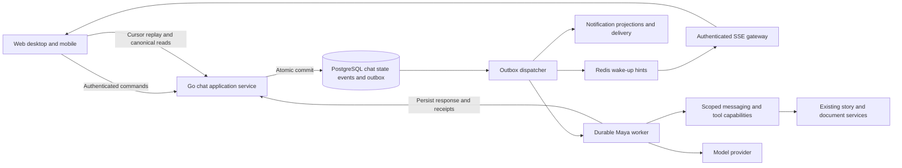

# Native team chat and Maya implementation plan

Status: Proposed architecture and delivery plan. No feature implementation is authorised by this document.

Research date: 16 October 2026. Initial capacity target: **1,000 concurrent users**, confirmed by the product owner. Repository reference: `68c1fe28f128455c9bc78c0d22574fe43f135c6f`, plus the working-tree changes described in the research register. Repository inspection establishes implementation context, not production deployment or load capacity.

## Intended outcome

FortyOne gains a dependable place for team conversations, with Chat in the main navigation. People discuss work, mention Maya, get grounded answers, turn a bounded conversation into tickets, claim ownership, and open the resulting work without losing the conversation. The quality bar is that people can trust both the conversation history and the work Maya performs.

The selected visual direction has the existing FortyOne outer navigation and command bar, a Chat navigation column, team conversations, a message stream, and an optional thread or ticket detail panel. The screenshots are concept references, not specifications for every field or state.

The following product corrections supersede the generated screenshots:

- Use Maya's existing persisted identity, name, avatar URL, and existing avatar component.
- Display **Maya**, without an appended AI badge or repeated AI label.
- Include Maya naturally in the team member avatar stack and mention picker.
- Remove “Maya is in every team” and similar explanatory chrome.
- Preserve the distinction between a system actor and a human internally. Maya has no human seat, online status, read receipt, or ability to log in.
- Use the workspace's configured work-item terminology in the UI. Existing backend entities remain stories; the current workspace displays tickets.

## Reading order

| Document                                                                  | Purpose                                                                                                                                     |
| ------------------------------------------------------------------------- | ------------------------------------------------------------------------------------------------------------------------------------------- |
| [Product and interaction specification](01-product-and-interactions.md)   | Scope, exact behaviours, screenshots-to-product decisions, conversation rules, and the moments that should feel exceptional.                |
| [Backend data and realtime architecture](02-backend-data-and-realtime.md) | Module boundaries, schema, APIs, transactions, ordering, replay, authorisation, files, search, and retention.                               |
| [Maya orchestration and intelligence](03-maya-orchestration.md)           | Identity, context selection, shared-audience safety, tools, execution receipts, retries, streaming, models, cost controls, and evaluations. |
| [Clients and notifications](04-clients-and-notifications.md)              | Web, desktop, mobile, composer/feed/cache contracts, unread state, push, email, badges, and accessibility.                                  |
| [Delivery quality and operations](05-delivery-quality-and-operations.md)  | Dependency-ordered work packages, capacity assumptions, launch gates, testing, observability, rollout, recovery, and ownership.             |
| [Research and decision register](06-research-and-decisions.md)            | Current repository evidence, external primary sources, rejected alternatives, assumptions, and decisions to settle before implementation.   |

## Recommended architecture

Keep the modular Go monolith. Add a first-class `chat` domain for native multi-user communication, use PostgreSQL as the authority, and use a transactional outbox for asynchronous effects. Adapt the existing scoped messaging/Maya capabilities rather than building a second independent agent system. Run Maya in durable background jobs that continue when a browser closes.

Use authenticated HTTP for durable commands and an upgraded shared SSE connection for server updates at the initial target. Replay is an application protocol backed by persisted conversation events and explicit cursors; Redis Pub/Sub is a low-latency wake-up path. Do not treat an open socket, a Redis publish, or a push-provider acceptance as proof that a user received or read a message.

The existing realtime feed, personal AI transcript storage, and document CRDT service each solve different problems. They provide reusable pieces, but none is the complete storage or delivery contract for native chat.

## The complete Maya experience

1. Joseph posts “@Maya create tasks from the last 10 messages.” The structured mention identifies the existing Maya principal.
2. The message, its trigger, and the durable run intent commit together. Joseph sees his accepted message and a brief Maya status.
3. The server freezes the exact preceding message IDs and revisions in the current channel or thread. “Last 10” does not drift as new messages arrive.
4. The context builder excludes unavailable, deleted, private, or audience-incompatible material. Maya gets the current team's permitted workflow metadata and a small, task-specific tool set.
5. Maya identifies useful work, checks for previously created or matching tickets, and returns a typed action plan. The server validates scope, fields, limits, and the requester's current authority.
6. A clear, bounded, same-team creation request can execute under the proposed native-chat action policy. Ambiguous instructions produce a targeted question; suggestions and broader changes use an explicit preview.
7. Each committed action has a durable receipt. Worker retries recover those receipts instead of creating the same tickets again.
8. Maya's answer displays actual ticket IDs and live, permission-checked previews. Users can assign an unassigned ticket to themselves through a conditional mutation, or open its details beside the chat.
9. The ticket preserves Joseph as the authorising human and records Maya's role separately, with links to the source conversation. Notification aggregation presents one coherent result instead of a burst of overlapping alerts.

The detailed policy, including cancellation and partial failure, is in [Maya orchestration](03-maya-orchestration.md). This fast path is an explicit change for native chat; it must not silently alter personal Maya or Slack behaviour.

## Scope and delivery sequence

The destination includes team conversations, threads, reactions, attachments, mentions, search, saved/read state, direct messages, useful notifications, and Maya. Deliver these as testable vertical slices.

| Stage                                       | Usable result                                                                                              | Entry to next stage                                                              |
| ------------------------------------------- | ---------------------------------------------------------------------------------------------------------- | -------------------------------------------------------------------------------- |
| Foundation                                  | Stable contracts, authorisation model, identity, event ledger, replay, and measured transport prototype.   | Concurrency and failure tests demonstrate durable ordering and tenant isolation. |
| Human team chat                             | Internal teams can exchange messages, reply, react, attach files, reconnect, search, and manage attention. | Cross-device consistency and notification policy pass the pilot matrix.          |
| Maya read capabilities                      | Mention Maya for grounded questions, thread summaries, and catch-up.                                       | Source and shared-audience evaluations meet launch thresholds.                   |
| Maya work creation                          | Explicit conversation-to-ticket flow, real previews, conditional assignment, audit, and recovery.          | Crash/retry, ambiguity, authorisation, and action-quality gates pass.            |
| Private communication and client completion | One-to-one human DMs, a private Maya entry point, mobile/desktop parity, notification tuning.              | Privacy and lifecycle matrix passes across all clients.                          |
| Controlled general availability             | Tested 1,000-user operating target, runbooks, budgets, retention, support, and staged rollout.             | Production canary evidence meets the stated release gates.                       |

Human DMs are part of the overall plan because they appear in the selected direction. They are a separate release gate, not a reason to delay the first team pilot. Group DMs, arbitrary private channels, voice/video, federation, full Slack history import, and automatic monitoring of every conversation remain later work.

## Non-negotiable contracts

- A successful send means the canonical message and required durable effects are committed.
- A retry with the same logical send identity cannot create another message.
- A retry or worker crash cannot repeat a committed Maya action.
- Every shared answer is safe for its destination audience, not merely accessible to its requester.
- Read state follows what a person actually viewed; receiving a network event or opening a notification is insufficient.
- A channel read does not mark unseen thread replies as read.
- File access, search, previews, notifications, and replay use the same current membership boundaries as messages.
- Removing a member stops new access and pending deliveries. Cached content is evicted on the clients we control; previously viewed information cannot be retracted from a person.
- Human messaging remains usable when Maya or its model provider is unavailable.
- No paid infrastructure or production capacity is assumed to exist merely because the repository contains an implementation.

## What must be decided before coding

Adopt the proposed native-chat action policy and history/retention defaults; confirm team-chat availability for guests and machine credentials; choose the attachment scanning service; run the transport/native-client spike; and assign the work-package owners. These are implementation decisions, not reasons to pause research. The [decision register](06-research-and-decisions.md) supplies a recommended default and consequence for each.

## Completion definition

The feature is complete when the behaviour, correctness, AI evaluations, accessibility, client support, migration, operations, and production canary gates all pass. A working screenshot, a successful model demo, passing unit tests, or a deployed API alone does not meet this definition.
